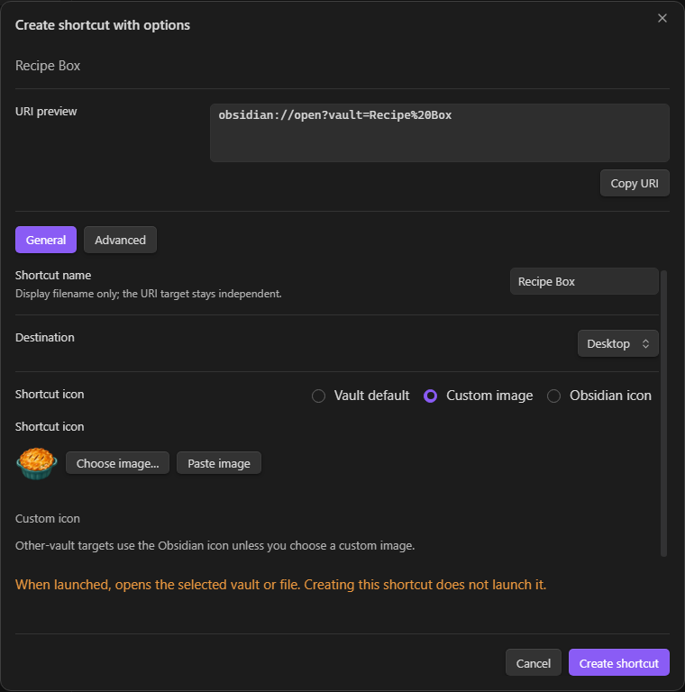

# Vault Shortcuts

Open your vault, jump to a note, or capture an idea from a shortcut on your desktop.
Windows users can also create Start menu shortcuts.

## Get started

Install **Vault Shortcuts** from Obsidian’s Community plugins browser and enable it.
This README describes the upcoming **1.0.0** release, which requires **Obsidian desktop 1.15.0+**.

- **Windows:** supported, with Desktop and Start menu destinations
- **macOS and Linux:** experimental; native appearance and launching are not yet verified
- **Mobile:** not supported

## Create a shortcut

- **Vault:** Settings → Vault Shortcuts → **Create shortcut**
- **File:** right-click a note or attachment → **Create desktop shortcut**
- **Folder:** right-click a folder → **Create folder shortcut…**
- **Tag:** right-click a tagged note → **Create tag shortcut**
- **Another vault:** Settings → Vault Shortcuts → **Create shortcut to another vault**

Shortcuts are saved outside the vault, on your system Desktop or in your Windows user account’s Start menu Programs folder.
Existing files are preserved, with numbered names for duplicates.
Double-click a shortcut to use it; creating one does not launch it.

## Make it your own

Choose **Create shortcut with options…** to customize the name, destination, icon and action.
The URI preview shows what the shortcut will do before you create it.

- Open a vault, file, heading or block
- Create a note, append or prepend text, or replace a note’s contents
- Open today’s daily note, capture into it, or create a unique note
- Search a folder, tag or custom query

Writing actions default to using your clipboard **when the shortcut launches**, with fixed text and empty-content options also available.
**Replace overwrites note contents**, and fixed text is stored in the shortcut itself.
Daily notes, unique notes and searches require their corresponding core plugins.

Folder shortcuts can create a fresh note inside the clicked folder or search it and its descendants.
Leave the note name blank to get a new numbered Untitled note on each launch.

## Custom icons

Choose a PNG, JPEG or ICO image—or use **Paste image**—for one shortcut or as the vault default.
Changing the default affects new shortcuts only.

Icon copies are stored locally outside your vault and remain after uninstall so existing shortcuts keep working:

- **Windows:** `%LOCALAPPDATA%\VaultShortcuts\Icons`
- **macOS:** `~/Library/Application Support/VaultShortcuts/Icons`
- **Linux:** `$XDG_DATA_HOME/vault-shortcuts/icons`, or `~/.local/share/vault-shortcuts/icons`

Reselect images on another computer; copying a macOS shortcut can lose its Finder icon metadata.

## A few things to know

- Rename or move a target? Recreate its shortcut.
- Vault names must match; duplicate names can be ambiguous, while vault IDs are device-local.
- Other-vault discovery and **Verify ID** use the official CLI: enable **Settings → General → Command line interface**, register it on PATH, then restart Obsidian; manual vault entry works without it.
- Native system commands locate destinations, and macOS uses a system helper to apply custom icons.
- File paths containing `#` are unsupported; heading and block navigation have separate controls.
- Context-menu toggles hide menu items without disabling commands or settings actions.
- Windows controls Start menu visibility and pinning; Linux launch support depends on the desktop environment.

[Report a problem](https://github.com/vincentlaucsb/obsidian-vault-shortcuts/issues) with your OS, Obsidian and plugin versions, the action you tried, and any error message.

[More screenshots](docs/images/listing/README.md) · [Downloads](https://github.com/vincentlaucsb/obsidian-vault-shortcuts/releases) · [Development](docs/DEVELOPMENT.md) · [MIT license](LICENSE)
