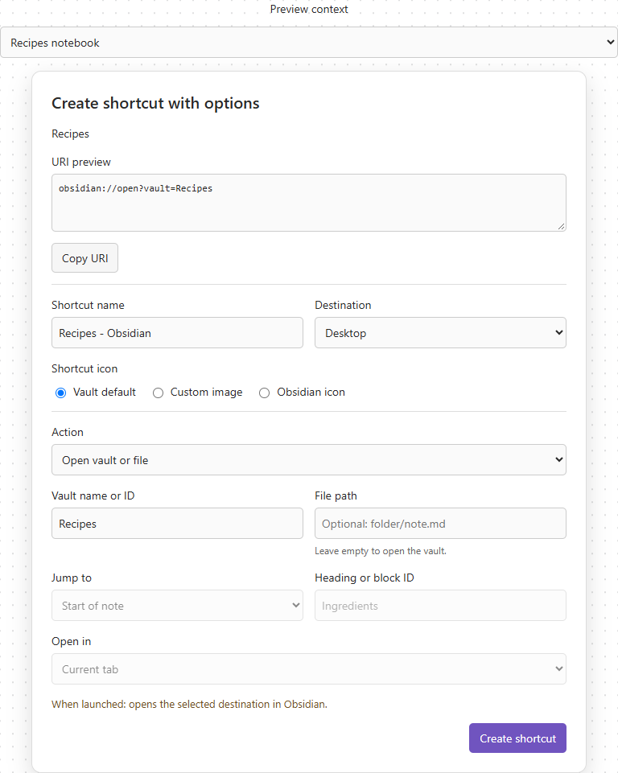
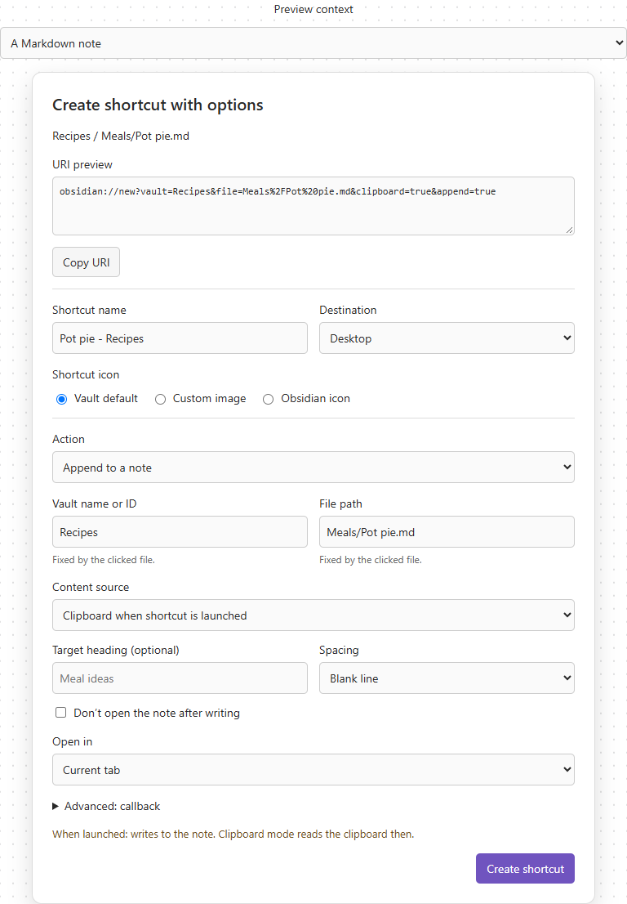

# Vault Shortcuts 1.0.0: URI options design

Approved implementation specification, November 11, 2026. The 1.0.0 work follows
this design. Publishing and merging remain outside the current request.

## Preview images

The images below preserve the original approved single-page concept. The later
tabbed revision described under Dialog composition supersedes their layout.

Notebook context:

Fixed-note context:

## Decisions and reference

- Target 1.0.0 with broad coverage of documented core Obsidian URI actions.
- Use the user's two-page sketch and subsequent tabbed revision: fixed live URI
  at the top, General for shortcut destination/icon, Advanced for URI controls.
- The user confirmed a read-only live URI preview with Copy and structured
  controls, rather than editing/pasting arbitrary URIs.
- The user confirmed writing actions in a note-context dialog. Vault identity and file
  remain fixed to the clicked note. Vault addressing can switch between its name
  (default) and a manually pasted, host-verified ID. Navigation and writing are supported without
  allowing a shortcut to silently target a different vault or file.
- Existing immediate creation actions remain convenient secondary paths.

Primary references, checked November 11, 2026:

- [Core URI reference](https://obsidian.md/help/uri).
- [Maintained English source](https://github.com/obsidianmd/obsidian-help/blob/master/en/Extending%20Obsidian/Obsidian%20URI.md).
- [1.15 URI changes](https://obsidian.md/changelog/2026-10-22-desktop-v1.15.0/).
- [Official release feed](https://raw.githubusercontent.com/obsidianmd/obsidian-releases/master/desktop-releases.json): stable 1.15.0; beta 1.15.1.

Recommendation: raise minAppVersion to 1.15.0 for the complete builder rather than
maintaining two capability sets. New heading/spacing features require this
baseline. Always emit an explicit append/prepend mode when using a write heading;
do not rely on the 1.15.1 beta's heading-only fallback.

## Dialog composition

1. Title: Create shortcut with options. Show the originating vault/file below it.
2. Read-only, wrapping URI preview and Copy URI action. Updates immediately.
3. General and Advanced tabs, with accessible keyboard navigation. Open General
   initially and preserve every draft when switching tabs.
4. General — Shortcut name: editable display filename, independent of URI file targets;
   auto-suggest from action/target until the user edits it.
5. General — Destination: Desktop; Start menu additionally on Windows.
6. General — Icon on every desktop OS: mutually exclusive vault default, custom image, Obsidian icon.
   Choosing custom reveals the existing picker and preview. Other-vault targets
   retain the standard-icon default, rather than inheriting Recipes' icon.
7. Advanced — Action selector. Friendly labels with optional core action names in help text.
8. Advanced — Target and action fields. Hide irrelevant field groups; retain disabled
   identity fields and short explanations where the user should see the constraint.
9. Advanced — Collapsed callback fields where supported.
10. Shared plain-language effect at launch, validation, Cancel and Create shortcut.

Production dialog: bounded height with only the active tab's content scrolling.
Keep URI preview and Copy fixed above the tabs; keep launch effect, validation and
creation controls visible below them, including when Advanced is hidden.
Selecting an action should preserve that action's draft values, but serialization
must use only active fields. Hidden state never leaks into a different action.

Creation writes a shortcut only. There is no automatic URI launch or Test action
that could accidentally create or overwrite a note during setup.

## Action coverage and proposed controls

| UI action | Core action | Proposed controls |
| --- | --- | --- |
| Open vault or file | open | Vault, optional file, navigation target, opening location. |
| Create a note | new | Current vault, filename/location, content source, opening behavior, existing-file policy. |
| Append / prepend / replace note contents | new | Target note, text/clipboard, mutually exclusive operation; heading and spacing for append/prepend. |
| Today's daily note | daily | Vault, open/capture mode; capture controls as applicable. Daily notes prerequisite. |
| Create unique note | unique | Vault, text/clipboard, opening location. Unique note creator prerequisite. |
| Search | search | Vault, optional query; reuse existing tag search as a preset. |
| Open vault manager | choose-vault | No note/vault fields. |
| Copy focused note address (Hook) | hook-get-address | Advanced integration; optional vault and callbacks. Dynamic focused note, not a fixed file. |

Do not claim coverage of arbitrary third-party protocol handlers. The first full
builder targets the documented core surface; shorthand URI forms add no new
capabilities and need no separate UI.

### Opening

Recommend an explicit target mode in the general builder: Vault only, File in a
vault, or Absolute file path. The latter is an advanced alternative, not another
field competing with vault/file. Bound-note context cannot select this alternative.
Keep vault-relative file paths and native absolute paths distinct.

Opening location: current tab (omit paneType), new tab, new tab group, new window.
Disable this for a vault-only action because no note is being opened.

Markdown navigation target: start, heading, or block ID. Use cached metadata for
suggestions in the current vault, with manual entry when metadata is unavailable.
Represent the file and navigation suffix separately and encode the resulting
parameter once. Preserve the existing rejection for a literal # in a file path;
an intentional heading/block suffix is a separate supported input. Attachments
retain full extensions and have no Markdown heading/block controls.

### Creating and writing

For new notes, offer default new-note location plus name, or an explicit
vault-relative file path. An absolute native path can be a general-builder
advanced mode after validating its compatibility; never enable it for bound notes.
Do not serialize name, file and path together. The user's sketch fixes the vault
to the current vault for Create a note; retain that behavior in the notebook view.

Content source: no initial content (creation only), specified text, or clipboard
when launched. A clipboard shortcut must not read or freeze the clipboard during
creation. Switching to clipboard excludes the text payload from the URI.

Use one operation control rather than independent append/prepend/overwrite
checkboxes. For bound notes, actions are explicitly Open, Append, Prepend, Replace;
there is no misleading Create-new-note action pointing at an existing note.

Heading and spacing are enabled only for append/prepend. Heading is optional;
spacing choices are blank line, new line and inline. Never silently convert
Replace into Append because a stale heading field remains populated.

"Don't open after writing" suppresses opening-location controls and excludes
paneType. Unique-note controls follow only its documented fields, rather than
inheriting every new-note flag. Daily's normal mode targets today's note using
Daily notes settings: do not add a misleading date/name/path override by default,
even though the reference broadly groups its parameters with new. Probe any
advanced daily override behavior before offering it.

Replace must be explicit, default off, and show its effect at launch next to the
creation button. Repeated activation can repeat writes. Literal text is stored
inside the shortcut; disclose this alongside existing external-file disclosures.

### Search and integration

Search accepts arbitrary user-entered core search text, including an empty query.
Tag shortcuts seed this field with the existing tag operand; preserve nested tags.
Do not silently make a note-origin search into a vault-wide action. If later
offering search within a fixed note, make that a separate explicit preset.

Advanced callback controls: x-success on new/daily/unique; x-success and x-error
on Hook. Do not assume every endpoint accepts every callback. Explain that the
destination app may receive note information; Obsidian's own callback permission
remains under user control. Encode a callback URI as one parameter value.

Hook's focused-note behavior belongs only in the general dialog. Label it clearly
as an integration action rather than promising a fixed-note shortcut.

## Context rules

| Context | Target | Available actions | Disabled/omitted options |
| --- | --- | --- | --- |
| Notebook/general | Current vault initially; known-vault/manual name or ID when coherent | All core action groups | Create note stays in current vault per sketch. Manager has no vault. Absolute-path target is separate. |
| Clicked Markdown note | Current vault by name (default) or verified ID; clicked file read-only | Open, append, prepend, replace | Different vaults, replacement file/path, daily, unique, vault manager, Hook and vault-wide search. |
| Clicked attachment | Current vault by name (default) or verified ID; clicked file read-only | Open | Writing, heading/block and other unrelated actions. |
| Tag shortcut | Current vault + selected tag query initially | Search preset | No implied clicked-note write target. |

Where disabled actions are visible, explain that they do not target this file.
Do not merely disable a vault textbox: bind immutable context in the request
model and validate it before writing. Recheck clicked-file identity immediately
before creation; handle deletion/rename without silently using another note.

In a clicked-file dialog, offer **Identify vault by: Vault name (default) / Vault
ID (device-local)**. Explain each mode's strengths and pitfalls inline: names are
readable and work across devices with matching names, but renames and duplicate
names are problems; IDs distinguish local registered vaults but are device-local
and may differ for synced copies, moves or re-registration. Use Obsidian's term
"vault ID", not a standard UUID. The [official URI reference](https://obsidian.md/help/uri)
describes its 16-character ID and Copy vault ID in the vault switcher.

The installed public API has no ID getter. Accept manual paste from the vault
switcher and explicitly verify it with the documented CLI command
`vault=<id> vault info=path`, comparing canonical paths with the current
FileSystemAdapter base path. Never read internal registries. Only enable ID-mode
creation after success; invalid, unrelated, missing-CLI and stale asynchronous
results cannot grant an alternate identity. Keep name mode available without the
CLI. Share the identifier choice across action drafts for the same clicked file.

Notebook/other-vault creation should share the builder without requiring the
plugin to be installed in another vault. Keep manual names/IDs and bounded CLI
discovery. Do not scan other notes, internal registries or private vault IDs.

## Architecture and validation

- Add a typed discriminated union for requests: open, note write, daily, unique,
  search, vault manager, Hook. Model text vs clipboard, write mode and target mode
  as exclusive choices. Keep immutable origin context separate from editable form.
- One pure URI builder and validator handles all actions. Existing builders and
  creator methods remain compatibility wrappers. Add one general creator path
  so OS classes write a validated URI without duplicating action logic.
- Keep shortcut filename, destination and icon separate from URI parameters.
- Keep form rendering, notices and metadata lookup in the Obsidian layer. OS
  creators retain directory discovery, serialization and exclusive creation.
- Encode each active parameter value once; omit inactive/false flags and never
  serialize a user-editable raw query string. Validate callback schemes/structure,
  absolute targets, empty required fields, line breaks and bound-target invariants.
- Native absolute-path mode must not accidentally override a bound vault/file.
- Reject unsupported combinations with an inline explanation, not silent coercion.
- No direct note-content reads/writes or eager clipboard reads are needed. Editing
  is delegated to core URI handling only when someone launches the shortcut.
- Keep durable icon imports, UTF-16LE BOM custom-icon Windows output, Linux
  escaping and collision-safe writing. No shell wrappers or new dependencies.

## Implementation and verification sequence

1. Settle the draft scope, including advanced absolute-path and Hook treatment.
2. Implement and test the union, serializer and validation matrix independently.
3. Build shared native controls, live preview/copy and bound-vault/note contexts.
4. Wire settings, file menu, tag and other-vault flows, preserving quick actions.
5. Test the actual production controls, not wholesale mocks. Cover action changes,
   stale hidden fields, fixed identities, clipboard-vs-text and destructive modes.
6. In an isolated test vault, deliberately verify launch effects for open/new,
   append/prepend/replace, daily, unique and search; callback integration requires
   a known local test destination. These tests explicitly launch test shortcuts;
   the plugin itself never launches them automatically. Do not use Recipes notes
   as mutation fixtures. Test heading/block navigation and missing prerequisites.
7. Verify normal/detached settings, image picking/cancel/import, Unicode targets,
   clipboard timing, shortcut display and Windows Desktop/Start menu output.
   Report unverified Mac/Linux behavior honestly.
8. Run strict typecheck, official lint, tests, production build and independent
   review before pushing. Align package, lockfile and manifest to 1.0.0 and the
   verified minimum version during implementation. No tag, release or merge here.

## Implementation decisions

- Use stable Obsidian 1.15.0 as the new minimum.
- Reuse the icon choices on every desktop OS. Windows retains multi-resolution
  ICO and `.url` fields; Linux uses an absolute PNG `Icon` path, and macOS applies
  the PNG as Finder metadata on the new `.url` through AppKit. Native macOS/Linux
  display and launch behavior remain experimental until tested on those systems.
  Storage is durable and device-local; copied Finder metadata may be lost through
  incompatible tools/filesystems. See README for paths and external access.
- Keep Hook/callbacks and absolute-path targeting in advanced controls.
- Keep normal daily shortcuts governed by Daily notes settings; expose unusual
  inherited parameters only after their behavior has been demonstrated.
- Use a dropdown for actions to keep the modal shorter than seven radio rows;
  retain radio choices for the three mutually exclusive icon modes in the sketch.

## Verification record

Implemented November 11, 2026. Strict TypeScript, official lint with zero warnings,
44 automated tests, and production build are checked locally on Windows. The real
modal regression exercises active/inactive fields, all action groups, copy,
clipboard deferral, immutable note context, attachment restrictions, custom-icon
state, filename independence, and async close/retry guards.

In a fresh isolated vault, actual Obsidian 1.15.0 URI launches verified Unicode
note creation, heading append, prepend, replacement, daily capture and unique-note
creation. Open/new-tab and search were visually inspected. Detached Recipes
Settings verified the actual modal, URI updates, action fields, validation and
PNG import/conversion/preview. No Recipes notes were modified by a writing URI.
Callback delivery and native Mac/Linux behavior remain unverified. Subagent review
is clean after resolving discovered UI-state issues.

The sentence-case lint rule omits URI from its default acronym list. A documented
override limited to ShortcutOptionsModal.ts recognizes the standard UI acronyms;
the rule remains active and the zero-warning lint requirement is unchanged.
